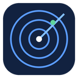

  

<h1 align="center">Gigradar</h1>

**Gigradar watches Upwork for you.** It checks your searches every 30 minutes (or less often) on your own PC,
scores every new job against your profile, and tells you about the good ones with a Windows notification and
optionally a Telegram message. A click on the notification opens the job in the app. No Upwork account, no API
key, no cloud service: everything runs on your machine.

Gigradar grew out of the command-line search tool for Upwork's public visitor API described in the root
[README](../README.md). The **Gigradar desktop app** is the part for people who never want to see a terminal.

## What the desktop app does

- **Onboarding wizard.** Describe what you do, add up to five searches (hourly, fixed or both), choose how to be
  notified, let the app check that Upwork lets it in, download the scoring model once. Then it runs by itself.
- **Scores for every job.** A small language model that runs **on your PC** (bge-small, no account, no upload)
  compares each job with your profile and gives it 0–100, the profile section it fits best and the skills that
  matched. Jobs the first run only "seeds" silently are scored too, so every job in the list has a number.
- **Notifications that open the job.** Windows toast (under the name and icon "Gigradar") and, if you want,
  Telegram through your own bot. One new job opens its card; several open the list of that check.
- **A minimum match score.** Jobs below it (default 20) are saved but not announced. When a check finds 3 new jobs
  and 2 are below your minimum, the message says "3 new jobs — 2 below your minimum score" and lists the rest. The
  Jobs list can show the hidden ones, dimmed and tagged "below minimum".
- **Rate jobs with 👍 / 👎.** Your ratings are stored with the job.
- **Status page.** One line says whether everything is fine; every check has a plain-language hint and, where the
  app can fix it, a button (set up again, check Upwork, download the model, schedule the checks).
- **Settings.** Profile, Preferences (skills, constraints, lowest rates, minimum match score), Searches,
  Notifications (toast, Telegram), Schedule (30 minutes to 4 hours, quiet hours) and Storage.
- **Keeps your history tidy.** Jobs are kept for 1 week, 2 weeks, 1 month (default) or forever; jobs you rated can
  be kept whole. A removed job leaves only a small marker so it never alerts again.
- **Runs without the window.** Closing the window hides it in the tray. The scheduled checks keep running even
  after "Quit".

## Install

**Windows 10 or 11, 64-bit, no administrator rights.**

1. Get `Gigradar_<version>_x64-setup.exe` (build it yourself, see [install-and-build.md](install-and-build.md);
   no download is published yet).
2. Run it. The installer is **not code-signed**, so Windows SmartScreen may say "unknown publisher": choose
   *More info → Run anyway*. It installs for your user only and adds the Microsoft WebView2 runtime if your PC lacks it.
3. Start **Gigradar** from the Start menu and follow the wizard (it includes one 67 MB model download).

Your settings and history live in `%LOCALAPPDATA%\Gigradar Data`. The uninstaller asks whether to delete that
folder too (it does not by default).

> ### You need a home (residential) internet connection
>
> Upwork's Cloudflare turns away **datacenter, VPS and many VPN addresses**. Gigradar is designed for a normal
> home connection, where its hidden browser page passes the check. If Upwork wants a human click now and then, the
> app tells you once ("Upwork needs a quick check") and shows a **Check Upwork** button; it never pops up a window
> by itself.

## Documentation

| | |
|---|---|
| [install-and-build.md](install-and-build.md) | Install the app, build the installer, run from source, uninstall |
| [requirements.md](requirements.md) | What the app needs (PC, network, accounts) and what building needs |
| [transparency.md](transparency.md) | What Gigradar contacts, what it stores and where, what it never does |
| [desktop-app.md](desktop-app.md) | How the desktop app is built and how its parts work |
| [windows-scheduler.md](windows-scheduler.md) | The scheduled task for a source checkout |
| [app-core.md](app-core.md) | The helper program (JSON command line) the app talks to |
| [real-pc-test.md](real-pc-test.md) | The manual test checklist for a real PC |

## Good to know

- Personal use only: a few searches, a check every 30 minutes at most, jobs are read-only. Gigradar never applies to
  jobs or writes to Upwork. Scraping may conflict with Upwork's Terms of Service; see
  [docs/transparency.md](transparency.md) and the [disclaimer in the README](../README.md#license--disclaimer).
- Without an Upwork account Gigradar sees what any visitor sees: the full job text, skills, budget, experience
  level, post time. It does **not** see the number of applicants, connects, or client details (those need a login).
- Gigradar is **not affiliated with Upwork.**
